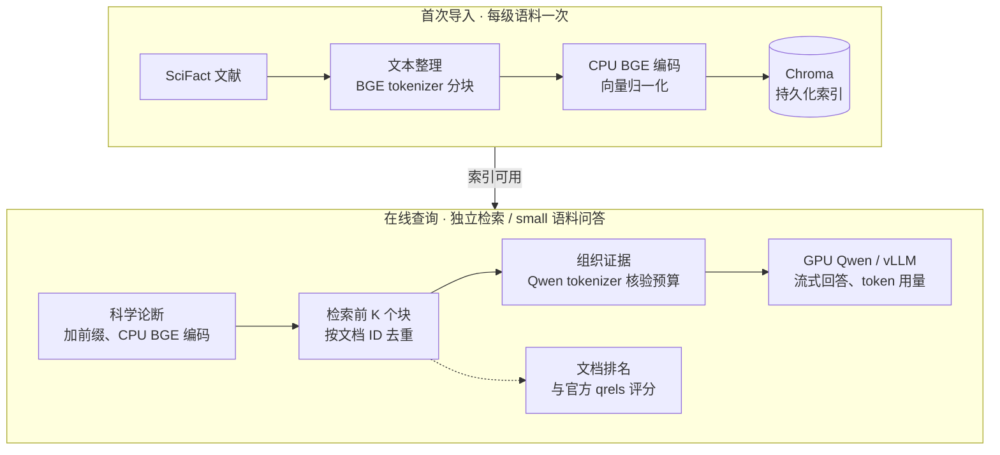
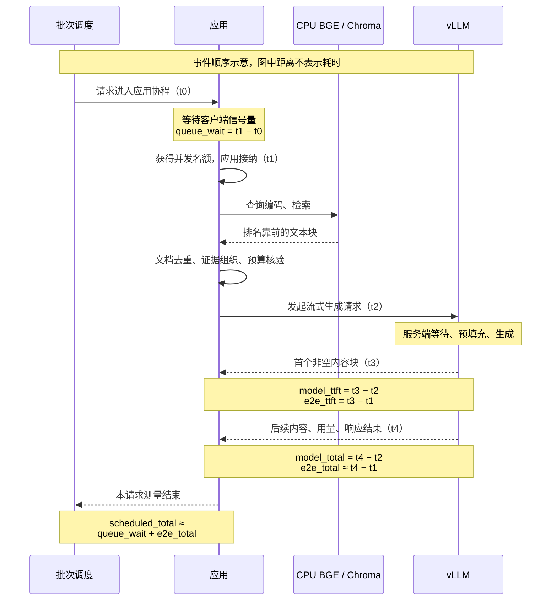

# MemMgr 基线实测报告

## 1. 测量范围与链路

本轮在 RTX 4050 / WSL 环境测量首次导入、独立检索和端到端问答，正式记录包含 **180 次检索与 112 次问答，全部成功**；问答记录包含服务端 token 用量。实验脚本全流程墙钟耗时 1172.43 秒。

参数定义、实验分组、计时公式和复现步骤见[实验设计](../docs/experiment-design.md)，回答质量与统计限制见第 6 节。

## 2. 数据与实验配置

### 数据

采用 [BEIR SciFact 官方数据](https://public.ukp.informatik.tu-darmstadt.de/thakur/BEIR/datasets/scifact.zip)，许可为 CC-BY-SA-4.0。数据说明见 [Hugging Face BeIR SciFact](https://huggingface.co/datasets/BeIR/scifact)，原始项目见 [AllenAI SciFact](https://github.com/allenai/scifact)。语料包含 5183 篇文献、1109 个科学论断，test 标注包含 300 个查询和 339 对查询—文献关系。

下载包 MD5 为 `5f7d1de60b170fc8027bb7898e2efca1`，SHA256 为 `536e14446a0ba56ed1398ab1055f39fe852686ecad24a6306c80c490fa8e0165`。随机种子固定为 7，检索使用 30 个固定问题，问答使用其中前 8 个。small、medium、full 分别包含 256、1500、5183 篇文献，形成嵌套子集，各级均保留所选问题的全部相关文献，覆盖率为 100%。正式抽样与实验参数见[基线配置](../config/baseline.json)。

### 环境与处理流程

| 项目 | 本次设置 |
|---|---|
| 运行环境 | Ubuntu 22.04 / WSL；RTX 4050，6141 MiB 显存；WSL 内存 7.6 GiB、交换空间 2 GiB |
| 软件 | Python 3.12.14；uv 0.12.12；vLLM 0.29.0；PyTorch 2.13.0+cu132；Transformers 5.17.0 |
| 生成模型 | Qwen2.5-1.5B-Instruct，FP16、eager；上下文上限 2048 token，输出上限 128 token；温度 0，种子 7 |
| 向量模型 | BAAI/bge-small-en-v1.5，CPU 编码，向量归一化 |
| 向量数据库 | Chroma 服务端及轻量客户端 1.5.3，命名卷持久化 |
| 文本整理 | 标题、空格、正文拼接，合并连续空白 |
| 文本分块 | BGE tokenizer 每块 384 token，重叠 32 token |
| 查询前缀 | `Represent this sentence for searching relevant passages: `；文献正文直接编码 |
| 生成上下文 | 逐文档取字符前缀，用 Qwen tokenizer 核验完整提示词预算 |
| 服务调度 | `max_num_seqs=1`，显存预算 80%；前缀缓存与分块预填充开启 |

本轮 GPU 优先用于生成，BGE 在 CPU 运行，以保留生成显存余量。GPU 嵌入同机常驻能力留作后续测量。

Qwen2.5-1.5B-Instruct 固定 revision 为 `989aa7980e4cf806f80c7fef2b1adb7bc71aa306`（Apache-2.0）；BAAI/bge-small-en-v1.5 固定 revision 为 `5c38ec7c405ec4b44b94cc5a9bb96e735b38267a`（MIT）。服务参数见[服务配置](../config/server.json)，下载清单见[模型配置](../config/models.json)。

## 3. 性能结果

vLLM 首次模型加载耗时 **12.791302 秒**，其中权重加载耗时 **9.92 秒**；模型加载占用显存 **2.98 GiB**。请求延迟从应用接纳开始计时。

### 首次导入

每级语料各记录一次首次导入。全流程计时截至数量校验和试检索完成；写入时间采用 Chroma 接收文本块并返回的耗时。已有 Chroma 索引按语料校验和与模型配置复用。

| 语料 | 文献数 | 文本块数 | 向量编码（秒） | 写入（秒） | 全流程（秒） | 编码吞吐（块/秒） | 写入吞吐（块/秒） |
|---|---:|---:|---:|---:|---:|---:|---:|
| small | 256 | 330 | 36.5585 | 1.5787 | 43.8137 | 9.0266 | 209.0368 |
| medium | 1500 | 1970 | 206.8448 | 6.5644 | 219.4725 | 9.5241 | 300.1027 |
| full | 5183 | 6854 | 715.1389 | 23.6392 | 748.5663 | 9.5842 | 289.9427 |

三个索引的预期数量与实际数量一致，试检索均成功。首次导入均为单次观测，表中列出实际测量值。

### 独立检索

每级语料使用 30 个问题、重复 2 次，正式样本数均为 60。检索候选为前 3 个文本块，计时覆盖查询向量编码和数据库检索。

| 语料 | 样本数 | 平均（秒） | 中位数（秒） | P95（秒） | 吞吐（请求/秒） | Recall@3 | nDCG@3 |
|---|---:|---:|---:|---:|---:|---:|---:|
| small | 60 | 0.024085 | 0.022674 | 0.031853 | 41.4608 | 0.8500 | 0.8125 |
| medium | 60 | 0.026160 | 0.022490 | 0.034559 | 38.1882 | 0.7333 | 0.6841 |
| full | 60 | 0.026286 | 0.023466 | 0.030981 | 37.9993 | 0.5778 | 0.5367 |

语料扩展后，固定样本的召回率下降，检索平均耗时保持在 24–27 毫秒。Recall 与 nDCG 按官方相关性标签计算。

### 端到端问答

问答统一使用 small 语料的 8 个问题，每组重复 2 次，正式样本数为 16。每组另有 1 次预热。B 为包含模板、问题和证据的完整输入 token 上限；K 为检索文本块数，C 为客户端并发数。第 2 组为参照，每组仅改变一个参数，服务端始终采用 `max_num_seqs=1`。

| 组别 | 输入预算 B（token） | 候选块数 K | 客户端并发 C | 改变量 |
|---|---:|---:|---:|---|
| 1 | 512 | 3 | 1 | 输入预算 |
| 2 | 1024 | 3 | 1 | 参照 |
| 3 | 1536 | 3 | 1 | 输入预算 |
| 4 | 1024 | 1 | 1 | 候选块数 |
| 5 | 1024 | 5 | 1 | 候选块数 |
| 6 | 1024 | 3 | 2 | 客户端并发 |
| 7 | 1024 | 3 | 4 | 客户端并发 |

| 组别 | 平均耗时（秒） | 中位数（秒） | P95（秒） | 首次内容平均等待（秒） | 请求/秒 | 输出 token/秒 |
|---|---:|---:|---:|---:|---:|---:|
| 1 | 0.937240 | 0.846588 | 1.930359 | 0.112849 | 1.0663 | 48.2496 |
| 2 | 1.062893 | 1.132663 | 1.649761 | 0.098840 | 0.9403 | 49.8344 |
| 3 | 1.110888 | 1.162107 | 1.941912 | 0.083436 | 0.8997 | 50.3843 |
| 4 | 0.904624 | 1.021336 | 1.425050 | 0.076836 | 1.1047 | 52.0609 |
| 5 | 1.195383 | 1.175362 | 2.460614 | 0.095656 | 0.8361 | 50.6884 |
| 6 | 1.768055 | 1.707095 | 2.638973 | 0.837910 | 1.0249 | 54.3218 |
| 7 | 3.242638 | 3.281003 | 4.432631 | 2.286821 | 0.9975 | 52.8664 |

增加客户端并发后，服务端等待时间上升，整体吞吐维持在约 1 请求/秒。K=1 时，8 个问题的 Recall 为 0.6250、nDCG 为 0.6250；K=3、5 时分别为 0.8750、0.7664。

实际输入量取决于候选证据长度。下表给出服务端记录的平均 token 数和范围，以及两次重复的平均问答耗时。

| 组别 | 输入 token：均值（范围） | 输出 token：均值（范围） | 两次重复的平均问答耗时（秒） |
|---|---|---|---|
| 1 | 512（512–512） | 45.250（14–95） | 0.949400 / 0.925080 |
| 2 | 861.875（528–1024） | 53.000（14–82） | 1.088340 / 1.037447 |
| 3 | 882.750（528–1125） | 56.000（14–99） | 1.110611 / 1.111165 |
| 4 | 390.250（169–568） | 47.125（19–75） | 0.913243 / 0.896005 |
| 5 | 974.250（627–1024） | 60.625（14–128） | 1.209179 / 1.181588 |
| 6 | 861.875（528–1024） | 53.000（14–82） | 1.768662 / 1.767448 |
| 7 | 861.875（528–1024） | 53.000（14–82） | 3.218620 / 3.266655 |

### 阶段耗时与单请求速率附表

应用排队发生在接纳前，单列于问答耗时；服务端等待包含在生成阶段内。实际字段取相邻的单调时钟读数，因此图中的加法关系有少量计时代码开销。完整字段定义见[实验设计的计时指标](../docs/experiment-design.md)。

以下耗时列按“平均 / 中位数 / P95”排列，单位为秒。纯检索每级 n=60、重复 2 次；问答每组 n=16、重复 2 次。

| 纯检索语料 | 查询向量编码（秒） | 数据库检索（秒） |
|---|---|---|
| small | 0.015668 / 0.015051 / 0.023947 | 0.008401 / 0.007866 / 0.012660 |
| medium | 0.017800 / 0.014078 / 0.024274 | 0.008345 / 0.007661 / 0.012321 |
| full | 0.015691 / 0.014847 / 0.022940 | 0.010578 / 0.008097 / 0.010763 |

| 问答组别 | 查询向量编码（秒） | 数据库检索（秒） | 上下文组织平均值（秒） | 应用排队（秒） |
|---|---|---|---:|---|
| 1 | 0.015510 / 0.015842 / 0.017802 | 0.009988 / 0.009172 / 0.019268 | 0.010412 | 3.648233 / 3.726448 / 6.493838 |
| 2 | 0.018330 / 0.016550 / 0.037786 | 0.010559 / 0.008354 / 0.018891 | 0.009544 | 3.932292 / 4.046536 / 7.125008 |
| 3 | 0.017741 / 0.016961 / 0.026190 | 0.008867 / 0.008381 / 0.012128 | 0.004915 | 4.011215 / 4.084009 / 7.363901 |
| 4 | 0.016446 / 0.015285 / 0.025222 | 0.011335 / 0.008202 / 0.024870 | 0.002455 | 3.295841 / 3.336461 / 6.109216 |
| 5 | 0.017405 / 0.015696 / 0.038322 | 0.009048 / 0.008969 / 0.015041 | 0.016659 | 4.696554 / 5.023255 / 8.025316 |
| 6 | 0.023772 / 0.019712 / 0.054117 | 0.008529 / 0.007976 / 0.014990 | 0.007827 | 2.860927 / 2.938591 / 5.684577 |
| 7 | 0.034996 / 0.021773 / 0.086384 | 0.010127 / 0.008650 / 0.021375 | 0.009179 | 1.496169 / 0.767982 / 4.433160 |

生成阶段从发起流式请求至响应结束，包含服务端等待。单请求输出速率采用该请求的服务端输出 token 数除以生成阶段耗时；下表速率列同样按“平均 / 中位数 / P95”排列。

| 问答组别 | 模型首次内容等待（秒） | 生成阶段总耗时（秒） | 单请求输出速率（token/秒） |
|---|---|---|---|
| 1 | 0.076929 / 0.070504 / 0.140137 | 0.901320 / 0.808646 / 1.898040 | 48.888169 / 50.216103 / 54.797623 |
| 2 | 0.060399 / 0.056210 / 0.112789 | 1.024452 / 1.101820 / 1.567082 | 50.847980 / 51.979960 / 54.864837 |
| 3 | 0.051905 / 0.050311 / 0.072643 | 1.079357 / 1.134024 / 1.912019 | 51.558166 / 52.187207 / 54.766812 |
| 4 | 0.046592 / 0.045221 / 0.058933 | 0.874379 / 0.982970 / 1.395493 | 53.572423 / 54.062474 / 55.992318 |
| 5 | 0.052534 / 0.046903 / 0.113014 | 1.152261 / 1.132498 / 2.419674 | 51.807588 / 51.902492 / 55.518120 |
| 6 | 0.797774 / 0.859502 / 1.550900 | 1.727918 / 1.669335 / 2.571615 | 31.321876 / 31.759762 / 54.737555 |
| 7 | 2.232511 / 2.601876 / 3.248407 | 3.188327 / 3.221484 / 4.328649 | 19.229220 / 14.264181 / 55.098054 |

### 资源观察

| 资源 | 采样观察值 |
|---|---|
| GPU 整卡 | 总显存 6141 MiB；已用显存最高 5092 MiB；利用率最高 100% |
| WSL | 内存使用最高 5,243,224,064 字节；交换空间使用最高 540,880,896 字节 |
| Python 进程树 | 测量进程 RSS 最高 1,347,145,728 字节；vLLM 进程树最高 2,858,246,144 字节 |
| Chroma 容器 | CPU 最高 13.86%；内存最高 177.5 MiB |
| 磁盘 I/O | 采样区间系统读取合计 50,081,792 字节、写入合计 971,915,264 字节 |

主机资源目标采样间隔为 1 秒，Docker 约每 5 秒采样。1041 个有效间隔的最小值、平均值和最大值为 1.000055、1.052539、2.080778 秒。各项峰值对应各自采样时刻。

## 4. 功能与服务检查

文本分块、命名空间隔离与提示词预算等 7 项回归测试通过；应用语义操作与重启后状态检查通过。最终服务检查显示 vLLM HTTP 200、Chroma 心跳成功，三个正式集合分别包含 330、1970、6854 个文本块。

## 5. 真实问答示例

**问题**

> The DdrB protein from Deinococcus radiodurans is an alternative SSB.

**问题中文翻译**

> 耐辐射奇球菌（Deinococcus radiodurans）的 DdrB 蛋白是一种替代性单链 DNA 结合蛋白（SSB）。

**检索与证据**

此问题探讨 DdrB 蛋白的单链 DNA 结合能力。检索与实际采用的文档 ID 均为 `15305881`、`14275671`、`4406819`。实际提示词中文档 `15305881` 的证据摘录为：

> ddrb forms a pentameric ring capable of binding single - stranded but not double - stranded dna.

**证据摘录中文翻译**

> DdrB 形成五聚体环状结构，能够结合单链 DNA，但无法结合双链 DNA。

**原始回答**

> The DdrB protein from Deinococcus radiodurans is an alternative SSB because it forms a pentameric ring capable of binding single-stranded but not double-stranded DNA, and its crystal structure reveals a novel fold distinct from other single-stranded binding proteins.

**回答中文翻译**

> 耐辐射奇球菌（Deinococcus radiodurans）的 DdrB 蛋白是一种替代性单链 DNA 结合蛋白（SSB），因为它形成的五聚体环状结构能够结合单链 DNA，但无法结合双链 DNA，且其晶体结构显示出一种有别于其他单链 DNA 结合蛋白的新型折叠结构。

该例来自第 2 组正式实验的第 1 次重复，问题 ID 为 `1163`，输入 1023 token、输出 58 token，以 `stop` 结束。

## 6. 适用范围与结果解释

本报告描述 RTX 4050 6 GiB 显存、WSL 7.6 GiB 内存、Qwen 1.5B FP16、CPU BGE 与本地 Chroma 的组件基线。后续模型和硬件实验可沿用数据与指标进行对照。

- **计时与吞吐**：各阶段采用单调时钟；首次内容等待取首个非空流式内容块的到达时间，每块可包含多个 token。问答从应用接纳请求后计时，应用排队单独记录。生成阶段包含服务端等待。整批吞吐采用实际批次耗时作分母，输出量采用服务端用量记录。客户端并发在服务端单序列条件下测量。
- **检索与缓存**：K 表示文本块候选数，应用按文档 ID 保留排名最前的块并去重；K=3 时实际得到 2–3 篇文档，K=5 时得到 3–5 篇。Recall 和 nDCG 将这一文档排名与官方标签比较。服务持续运行，各组有独立预热，跨组共享前缀缓存；组间延迟差异同时受证据量、生成长度和缓存状态影响。
- **样本与分位数**：检索为 30 个独立问题各重复 2 次；问答为 8 个独立问题各重复 2 次。P95 采用最近秩，问答每组 n=16 时对应样本最大值。报告以平均值、中位数和描述性 P95 展示本次观察。
- **回答质量**：36/112 条回答含行内引用，遵从率 32.14%，引用 ID 均来自实际采用的证据。第 5 组问题 1137 的两次回答均达到 128 token 上限，以 `length` 结束，共 2/112 条。上面的正式示例回答省略行内引用；使用前需核对事实、单位和引用。

## 7. 下一步

后续实验可比较 CPU 向量编码资源、较大生成模型和服务端调度并发，并以新的独立报告呈现结果。

7B 迁移步骤见[部署说明](../docs/deployment.md#6-实验室迁移)。
